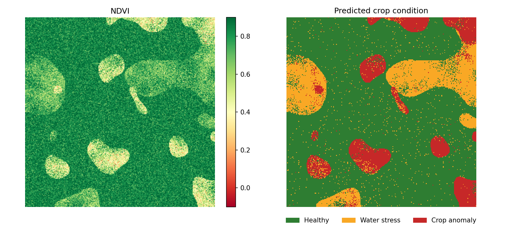
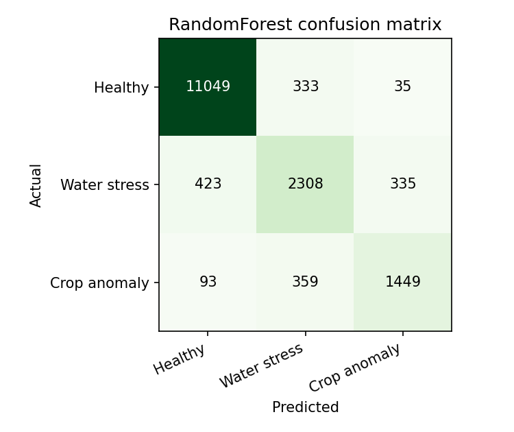
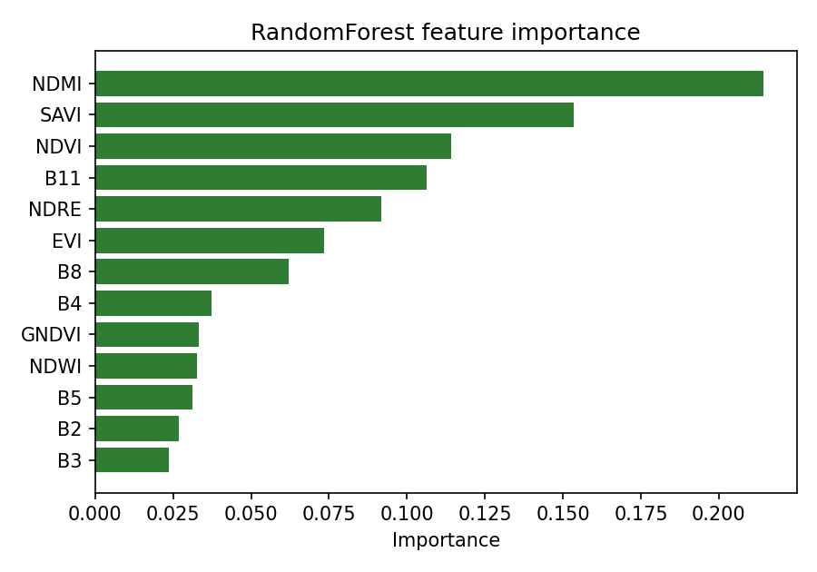
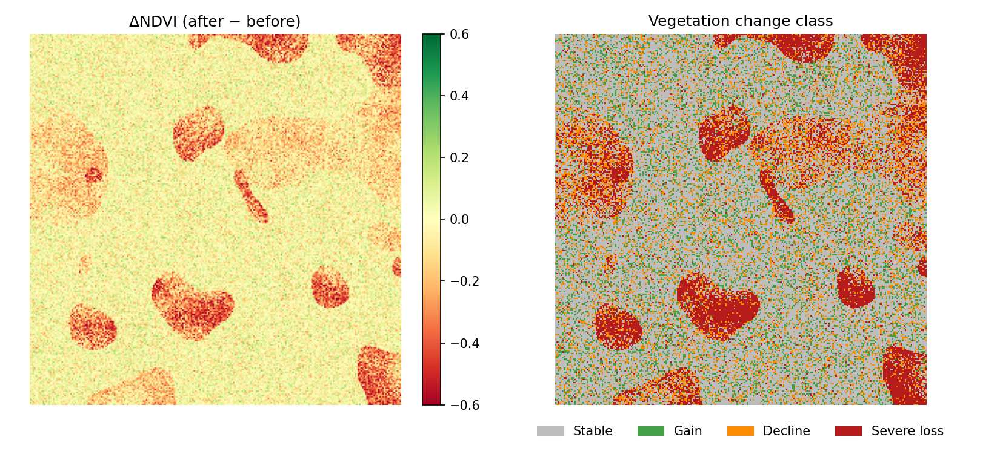

# 🌾 AI-Powered Satellite Crop Monitoring System

Geospatial machine-learning pipeline that turns Sentinel-2 imagery into **crop-health maps, stress/anomaly alerts, vegetation-change maps and yield estimates**.

**Stack:** Python · Google Earth Engine · scikit-learn (Random Forest) · XGBoost · rasterio · Streamlit · QGIS



## Pipeline

```
Sentinel-2 (GEE)  →  Cloud masking / preprocessing  →  Spectral indices (NDVI, EVI, SAVI, GNDVI, NDRE, NDWI, NDMI)
      →  Random Forest / XGBoost  →  Stress map (Healthy · Water stress · Crop anomaly)
      →  Change & anomaly detection  →  Yield model  →  Streamlit dashboard  +  GeoTIFFs for QGIS
```

## Features

| Module | What it does |
|---|---|
| `src/gee_download.py` | Cloud-masked (SCL) Sentinel-2 L2A median composite from Google Earth Engine → GeoTIFF |
| `src/features.py` | 6 bands + 7 spectral indices (vegetation, chlorophyll, canopy water/moisture) |
| `src/train.py` | Random Forest & XGBoost classifiers, **spatial block hold-out** (no neighbouring-pixel leakage), confusion matrix, feature importance |
| `src/predict.py` | Full-scene stress map (GeoTIFF + PNG) and area statistics in hectares |
| `src/change_detection.py` | NDVI differencing between dates (gain / decline / severe loss) + z-score anomalies |
| `src/yield_model.py` | Field-level yield regression (RF / XGBoost) |
| `src/rasterize_points.py` | Convert QGIS field-survey points into a label raster for real-data training |
| `app/dashboard.py` | Interactive Streamlit dashboard |

## Quick start (runs in ~30 s, no account needed)

```bash
git clone https://github.com/<your-username>/crop-monitoring.git
cd crop-monitoring
python -m venv .venv && source .venv/bin/activate      # Windows: .venv\Scripts\activate
pip install -r requirements.txt

python run_pipeline.py            # generate demo data → train → predict → change → yield
streamlit run app/dashboard.py    # open the dashboard
pytest -q                         # unit tests
```

Without any download the pipeline uses a **synthetic Sentinel-2-like scene** (realistic class overlap, noise and spatial patches), so results demonstrate the pipeline, *not* real-world agronomy.

## Using real satellite data

```bash
earthengine authenticate
# 1. Download composites for two dates (keep the AOI ~10 x 10 km)
python -m src.gee_download --project YOUR_GCP_PROJECT --bbox 79.85 13.10 79.95 13.20 \
       --start 2025-06-01 --end 2025-06-30 --out data/raw/scene_before.tif
python -m src.gee_download --project YOUR_GCP_PROJECT --bbox 79.85 13.10 79.95 13.20 \
       --start 2025-08-01 --end 2025-08-31 --out data/raw/scene_after.tif

# 2. Label field-survey points in QGIS -> CSV with columns lon,lat,label (0 healthy, 1 water stress, 2 anomaly)
python -m src.rasterize_points --raster data/raw/scene_after.tif --csv my_points.csv

# 3. Run everything on your data
python run_pipeline.py --use-existing
```

For real yield modelling: `python -m src.yield_model --csv fields.csv` (columns: `NDVI,EVI,NDRE,NDWI,NDMI,GNDVI,yield_t_ha`).

## Open the results in QGIS

1. `Layer → Add Layer → Add Raster Layer` → `outputs/stress_map.tif`
2. Right-click → *Properties → Symbology* → **Paletted/Unique values**: `0` green, `1` amber, `2` red
3. Add `outputs/ndvi_change.tif` (Singleband pseudocolor, RdYlGn, −0.6…0.6) and overlay field boundaries
4. *Raster → Raster Calculator* or *Zonal Statistics* to summarise stress per field polygon

## Demo results (synthetic data, spatial hold-out)

| Model | Accuracy | Macro-F1 |
|---|---|---|
| Random Forest | ~0.90 | ~0.83 |
| XGBoost | run to reproduce | run to reproduce |

<p float="left">
  
  
</p>



## Project structure

```
crop-monitoring/
├── run_pipeline.py        # one-command pipeline
├── config.py              # bands, classes, thresholds, paths
├── requirements.txt
├── src/                   # gee_download, features, train, predict, change_detection, yield_model, ...
├── app/dashboard.py       # Streamlit UI
├── tests/                 # pytest unit tests
├── docs/                  # result images
├── data/raw/              # input rasters (git-ignored)
├── models/  outputs/      # generated (git-ignored)
```

## Roadmap
- [ ] CNN patch classifier and U-Net field-boundary/stress segmentation (PyTorch)
- [ ] Multi-date NDVI time-series (phenology, anomaly vs. seasonal baseline)
- [ ] Real ground-truth yield data + weather covariates (rainfall, temperature)
- [ ] Docker image and scheduled GEE ingestion

## License
MIT
